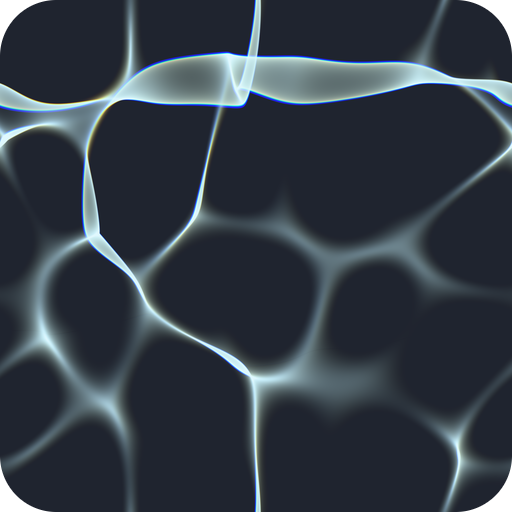
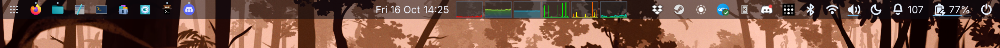

# caustics



A status bar for Wayland compositors that draws everything on the GPU. The
layout, the hit-testing, the text shaping and the glyph rendering all run in
[Slang](https://shader-slang.org/) compute shaders; the CPU side is a small
process that owns the Wayland surface and a set of pipes, and a handful of
helper programs that talk to the rest of the system. The shader is one program
you can edit while the bar is running.

What it shows: a dock with pinned and running applications and hover previews
of their windows, a system tray, charts, a clock with a calendar, and menus for
battery and power, audio, network and Bluetooth, plus an idle-inhibit toggle,
a notification daemon with toasts, and an on-screen display for volume and
brightness changes.



*The top of a 2880 px output at scale 2.*

Paths in this file are from the repository root.

## How it works

There are three kinds of program, with a hard line between them.

**The bar process** (`bar/`, the `caustics-bar` binary) owns the Wayland objects
(one layer-shell surface, its popups, the pointer), the GPU device, the
compositor's IPC socket and a set of pipes. It decides nothing. It writes what
it knows (the windows, the dock's entries, the time) into GPU buffers, copies
what its sidecars send into GPU buffers byte for byte, and carries out the
actions the shader decides without interpreting them. The mechanism under it
(the device, the caustic's pipelines and their hot reload, the sidecar
supervisor) is a library crate, `caustics-host` (`host/`), which any program
that hosts a caustic can use and of which the bar is the first client.

**Sidecars** (`sysmon/`, `tray/`, `power/`, `audio/`, `network/`,
`bluetooth/`, `notify/`, `apps/`, `glyphs/`, `reload/`) are separate processes
the bar starts. Each talks to one part of the system, such as D-Bus, `/proc`,
fontconfig and the font files, icon themes, desktop entries or the shader
compiler, and writes length-prefixed binary frames to its stdout. The bar
parses none of them: a sidecar's frame goes to the GPU as it is. A crashed
sidecar is restarted and its feature is absent meanwhile. A sidecar whose
service is missing (no NetworkManager, no BlueZ) publishes nothing, and its
chip is not shown.

**The caustic** (`caustics/bar.slang` and the modules it imports) is
everything you can see and every decision about it: the layout, the dock's
order, which menu is open, what a click means, how a string is shaped, how
each glyph is filled. It is compiled to SPIR-V and hot-reloaded: save a
`.slang` file and the running bar swaps its pipelines within a second, keeping
its open menu and its animations. A file that does not compile leaves the last
good bar running and prints the compiler's diagnostic. A bad change is wrong
pixels, never a dead bar.

The line between them is a rule. Code lives in the bar process only if it owns
a Wayland object or a file descriptor the bar holds, sits on a
configure/acknowledge round trip, or must decide before forwarding an event
synchronously. Everything else is either computation over data, which is the
shader's, or I/O that is not the bar's own, which is a sidecar's. The bar
process links no D-Bus library, no async runtime, no font stack, no image
decoder and no shader compiler, so none of those can crash it, stall it, or
wake a sleeping GPU.

### Text on the GPU

The parts usually left on the CPU are the shader's too. The text engine is
[punchcutter](https://github.com/davidar/punchcutter), a dependency whose Slang
modules the bar's shader imports:

- **Strings.** Every label the bar itself shows (a menu row, a weekday) is a
  string literal in Slang. The compiler's reflection carries the literal's
  text, the bar copies it to the GPU, and the shader shapes it. No CPU code
  knows what a menu says, so a label's wording is configuration like a colour.
- **Glyphs** are filled per pixel from the font's Bézier outlines with the
  Slug algorithm. A font goes to the GPU once as curves. Nothing is rasterised
  per size, so there is no glyph atlas, and any scale is exact.
- **Icons.** Symbolic icons are filled paths and are drawn the same way.
  Colour icons and tray pixmaps are images in a fixed array of slots.
- **Shaping.** The font's own OpenType tables (`cmap`, `hmtx`, `GDEF`, `GSUB`,
  `GPOS`) go to the GPU verbatim, and a Slang port of HarfBuzz's default
  shaper walks them in place, one thread per string. It is checked against
  harfrust, HarfBuzz's Rust port, at zero tolerance over HarfBuzz's own test
  suite. Glyphs the font lacks are covered from fontconfig's fallback faces,
  appended on demand: the bar asks its font sidecar over a pipe and copies
  the answer into the GPU's buffers.

Done on the CPU, each of those was code in the bar process that had to
understand a format and could fail on someone else's input. Done in the
shader, it is hot-reloadable, bounded (every loop over font data is capped and
charged against a budget, and a watchdog stops a runaway pass), and gone from
the process that must not die. docs/architecture.md, *Text*, has what the bar
adds to the engine; what is not done yet (bidirectional text, complex-script
shapers, colour fonts) is on punchcutter's roadmap.

### One ABI, one set of binaries

Two contracts, both in docs/abi.md. **The buffer** is between the bar process
and the shader: built together, changed together, declared once in Rust in
`bar/abi/` with the Slang side rendered from it at build time, and a test that checks every
struct's layout against the compiler's reflection. **The wire** is between the
bar and its sidecars: framed, versioned as a whole, and readable by anything
that can write little-endian words. A third-party widget is a program that
writes frames; `bar/abi/examples/rows_demo.rs` is one.

Both contracts are hashed at build time into one number that every binary
carries. A sidecar's first frame says its hash, and the bar refuses a sidecar
built against another one. So the bar, its ten sidecars, the canvas host,
its sidecar and its client are **one set**:
`bar/install.sh` builds them together and installs them into a directory
named after the hash, with `~/.local/bin/caustics-bar` a symlink into it. A
running bar keeps its own set's sidecars even after a newer set is installed.

## Requirements

| | |
|---|---|
| **Rust** | 1.88 or newer (edition 2024; the workspace declares `rust-version`). |
| **Slang** | Nothing to install. The compiler runs in process, through the text engine's `punchcutter-slang`, which carries a pinned [Slang release](https://github.com/shader-slang/slang/releases) (**2026.14.1**) inside the binaries that compile: the bar's build script, the tests and `caustics-reload`. The first build downloads that release once, checks its SHA-256 and keeps it under `~/.cache/shader-slang/`; for an offline build, point `SLANG_RELEASE_ARCHIVE` at a local copy of the release archive. `spirv-val` checks every compiled module when it is installed. |
| **Libraries** | `libwayland-client` at link time (your distribution's `libwayland-dev` or equivalent). Fontconfig and an icon theme at run time; `libxkbcommon` at run time for the canvas, which types nothing without it (canvas/README.md). |
| **GPU** | Vulkan, through wgpu with SPIR-V passthrough. The bar asks for a low-power adapter and **refuses an adapter named NVIDIA** (a status bar must not keep a discrete GPU awake) unless `CAUSTICS_BAR_ALLOW_DGPU=1` is set; an NVIDIA-only machine sets that, or uses Mesa's lavapipe. Tested on AMD integrated graphics (RADV) and on lavapipe. |
| **Compositor** | `wlr-layer-shell` and `ext-foreign-toplevel-list` (required, for the bar and the dock); `xdg-activation` (a notification's click raising its app) and `idle-inhibit` (the caffeine toggle), each optional. **niri** for the rest: which window is focused or urgent, focusing, closing and launching from the dock, and the overview button go through niri's IPC socket (`$NIRI_SOCKET`). Without it the dock lists windows but cannot act on them, and the power menu's Log Out ends the session through logind instead of asking niri to quit. Hover previews need `ext-image-copy-capture` with the foreign-toplevel capture source, which at the time of writing is in a patched niri rather than upstream's; without it there are no previews and nothing else changes. |

**Session services**, one sidecar each. Any of them can be missing:

| service | sidecar | without it |
|---|---|---|
| NetworkManager (system bus) | `caustics-network` | no network chip |
| BlueZ (system bus) | `caustics-bluetooth` | no Bluetooth chip |
| UPower, logind, power-profiles-daemon (or tuned-ppd), a backlight | `caustics-power` | no battery chip, no power menu; no brightness slider without a backlight. The menu's **Lock** row asks logind, which only signals: a locker must listen (`caustics-lock`, canvas/README.md *Enabling the lock*, or another hooked to logind's `Lock`), else the row does nothing and the journal says so |
| PipeWire with WirePlumber (`wpctl`) and `pactl` (Debian and Ubuntu: `pulseaudio-utils`) | `caustics-audio` | no audio chip; PulseAudio alone has no `wpctl` |
| a session bus | `caustics-tray` | no tray (`caustics-tray` is the StatusNotifierWatcher when the name is free, and a host on the existing watcher when it is not) |
| the session bus's `org.freedesktop.Notifications` name | `caustics-notify` | see below |
| `/proc`, hwmon, drm sysfs; NVML on NVIDIA | `caustics-sysmon` | no charts (an absent sensor is a gap in its chart) |
| fontconfig and a sans-serif font | `caustics-glyphs` | **no text at all** |

`caustics-notify` **is** a notification daemon. It asks for the bus name allowing
replacement and replacing the current owner: a daemon that allows replacement
is replaced at once; one that does not keeps the name, and `caustics-notify` waits
behind it, publishing nothing. To keep your own daemon, start the bar without
`caustics-notify` by listing the other sidecars in `$CAUSTICS_SIDECARS`
(`bar/systemd/README.md`).

## Build and install

```sh
git clone <this repository> caustics && cd caustics
bar/install.sh                                          # build, install the set into ~/.local
systemctl --user link "$PWD/bar/systemd/caustics-bar.service"
systemctl --user enable --now caustics-bar
journalctl --user -u caustics-bar -f                        # every decision is one line
```

The unit is `WantedBy` `graphical-session.target`, so two things must be true
of the session, and a session started by `niri-session` or uwsm makes them
so: the user manager knows the display (`systemctl --user import-environment
WAYLAND_DISPLAY NIRI_SOCKET XDG_CURRENT_DESKTOP`, run by the compositor's
startup) and it reaches that target (a `sway-session.target` or uwsm's,
which pull `graphical-session.target` in). A plain sway or Hyprland
configuration does both with one `exec` line. Without them `enable --now`
starts a bar with no display, which exits and runs into its start limit, and
nothing starts the bar at the next login; `systemctl --user show-environment`
says whether `WAYLAND_DISPLAY` is there.

`bar/install.sh` builds the workspace in release mode, checks that all eighteen
binaries came from that build, installs them into
`~/.local/lib/caustics-bar/<abi-hash>/`, moves the symlink, restarts the unit if
it is installed, and prints the bar's first `set:` and `health` lines.
`--prefix DIR` installs elsewhere without a restart; `--from DIR` installs
binaries already built. Never install one binary on its own: the bar would
refuse a sidecar from another build anyway, and the script exists so that
there is no way to make that pairing.

Hot reload compiles against the text engine's Slang modules as they were
compiled into the set, with the Slang release compiled into it: the
compiler serves the modules from memory on every compile's search path, so
the engine and the compiler the bar runs with are the ones it was built
against, whatever has happened to cargo's caches since. `caustics-reload`
also writes them once into `~/.cache/punchcutter/slang/<hash>/`, to hash
into its cache key beside the modules it watches.

**On a laptop with a discrete GPU**, also install the iGPU-only drop-in,
which pins the Vulkan loader to the integrated GPU's driver so the discrete
GPU's driver is never loaded. Check the driver file it names against
`/usr/share/vulkan/icd.d/` first:

```sh
bar/install.sh --dropin bar/systemd/dropins/igpu-only.conf
```

`bar/systemd/README.md` covers the unit (restarts, exit codes, the memory
cap), the sidecars, and the journal lines worth knowing.

To try the bar without installing it, `cargo run -p caustics-bar` from the
checkout works too. The bar finds its sidecars beside its own executable in
`target/debug/`, so build the whole workspace first with `cargo build`.

## Configuration

There is no configuration file, on purpose. **The configuration is the
shader.** Every knob (colours, sizes, opacity, the edge and the height, which
items sit in which part of the bar and in what order, spring constants, the
dock menu's rows and wording, the clock's words and date order) is a
`public static const` in `caustics/bar_tunables.slang`, with a comment saying
what it does. To change the bar, edit that file in your checkout and save:

```sh
$EDITOR caustics/bar_tunables.slang      # save, and the running bar moves
```

The running bar moves on the save. A file that does not compile keeps the
last good bar and prints Slang's diagnostic to the journal. The shipped bar
sits on the top edge; `EDGE = EDGE_BOTTOM` moves it. The knobs live where
they are used, any constant can be tuned live, and the compiler is the
validator. After a `git pull`, your edits are a merge like any other.

Two things are not tunables. **The dock's favourites** are state, at
`~/.local/state/caustics/bar/favourites`, written by **Pin** and **Unpin** on a
dock entry's right-click menu. Until the first pin the dock shows only the
running windows. **A sidecar's
settings are its own**: `$CAUSTICS_SYSMON_CHARTS` picks the charts and
`$PUNCHCUTTER_FONT` the font (the text engine reads it), both set on the
unit. The bar launches no settings program: its menus do what the bar
does, and the rarer settings are your terminal's.

## Status

Daily-driven by its author as the only panel in a niri session on one AMD
laptop. Tested:

- by `cargo test --workspace`, and by an oracle that runs the shader's own
  passes on a real GPU with a real font (`CAUSTICS_BAR_ORACLE=1`);
- by the **nested gate** (`bar/nested-run.sh`, docs/testing.md): about 280
  checks against a nested niri on the machine's real GPU, inside a headless
  sway, with a private session bus. It is the merge gate for anything that
  touches the bar's Wayland side;
- by a smoke run in a virtual machine on lavapipe.

**Untested**: any host compositor but niri (sway, Hyprland, river, KDE Plasma
and others offer layer-shell, but focus and the dock's actions need a
compositor IPC implementation the bar does not have for them; GNOME offers no
layer-shell); NVIDIA GPUs; Intel GPUs; multiple outputs (the bar takes one
surface on the output the compositor gives it); right-to-left and
complex-script window titles beyond what docs/architecture.md, *Text*, lists.

**Accessibility: none.** There is no accessibility tree and no screen-reader
support.

## Non-goals

- **A configuration file.** The tunables module is the configuration.
- **Password entry**, or any text input, in the bar. A network's password is
  asked on the canvas's prompt. The canvas (docs/canvas.md), the
  wallpaper, fade, lock and prompt host designed beside the bar, is the one
  program in this tree that takes a password, and the bar is not it.
- **A widget toolkit.** Menus, sliders and toasts are immediate-mode layout
  in the shader; a third-party widget is a program that writes frames.
- **X11.** The bar is a Wayland client and needs a layer-shell compositor.

## Licence and credits

MIT (`LICENSE`); third-party notices are in `NOTICE`.

- **punchcutter**, the text engine: shaping and glyph coverage in Slang. Its
  own notices credit Slug, Eric Lengyel's algorithm for rendering glyphs from
  their outlines, whose reference shader it ports, and the Unicode data its
  shaper writes out; harfrust and HarfBuzz's test suite are the reference it
  is checked against.
- Built on wgpu, smithay-client-toolkit, zbus, tokio, nvml-wrapper and resvg,
  among the crates in `Cargo.lock`.

## The name

A caustic is the pattern light draws after it passes through something that
bends it: the bright, moving net on the floor of a swimming pool. Here the
medium is the GPU. A caustic is one compute program that takes the bytes the
bar copies in and decides and draws everything on screen from them (the bar's
is `caustics/bar.slang`), and the project is named for the plural, the
directory a reader opens first. The logo is one, simulated: `tools/logo/caustic.py`
traces light through a water surface with a ridge across it near the top, and
the band that ridge focuses is the bar. The pointer's wake on the bar is the
same physics per pixel; `tools/wake/wake.py` previews it off the GPU, with a
ray-splat ground truth beside the shader's approximation.

## Documents

- docs/architecture.md — the parts, how a frame runs, and the reason behind
  each decision.
- docs/abi.md — the buffer and the wire, byte for byte, and how to write a
  sidecar.
- docs/testing.md — the tests, the oracle, the nested gate and the VM target.
- docs/roadmap.md — what is not built yet.
- docs/canvas.md — the wallpaper, idle fade, lock screen, polkit prompt and
  greeter as one caustic on a second host (the wallpaper, the polkit
  sink and the lock sidecar are built; the rest is design).
- `canvas/README.md` — the canvas host as a user unit: the wallpaper, its
  socket and its client.
- `polkit/README.md` — the polkit sink: the authentication agent, its
  conversations over the wire, its dry run.
- `lock/README.md` — the lock sidecar: logind's lock and hint, the PAM
  conversation over the wire, its socket, its dry run.
- `secrets/README.md` — the secret agent: NetworkManager's questions as
  conversations over the wire, its dry run.
- `pairing/README.md` — the pairing agent: BlueZ's confirmations, PINs and
  passkeys as conversations over the wire, its dry run.
- docs/wire.md — the wire contract that replaces the ABI hash with an
  append-only rule, so sidecars from other trees can talk to the host
  (design).
- `caustics/README.md` — the shader files, the tunables, hot reload.
- `bar/systemd/README.md` — the install, the unit, the sidecars, the journal.
- `sysmon/README.md` — the charts' sidecar, and the lease it holds on NVML.
- `CONTRIBUTING.md` — the rules for a change.
- `CHANGELOG.md` — what exists.
